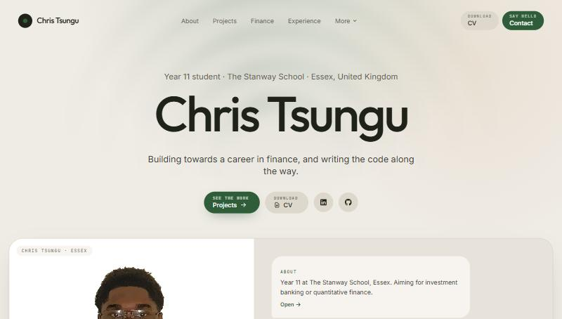

# Chris Tsungu Portfolio

Personal portfolio of Chris Tsungu, Year 11 student at The Stanway School, Essex, building towards a career in investment banking or quantitative finance.

[](https://github.com/callumtsungu200-coder/chris-tsungu-portfolio-/actions/workflows/ci.yml)

**Live:** https://chris-c-tsungu.netlify.app



Built with React 18, TypeScript, Vite, Tailwind CSS, Framer Motion and React Router. Hosted on Netlify (forms included).

**Design:** warm cream background, olive-charcoal text, coral and deep-green accents, Outfit headings with Inter body text, and large rounded cards. Motion is deliberate and specific: masked word reveals, clip-path wipes, a sheet that wipes between routes, count-up figures, a timeline rail that draws with scroll and a ticker. Everything respects `prefers-reduced-motion`. Colour tokens live in `tailwind.config.ts` (the `ink`/`gold` scale names are kept from v1 but remapped).

## Pages

| Route | What it is |
| --- | --- |
| `/` | Home, hero with professional photo, highlights, featured projects, "currently working on", experience summary, philosophy, timeline, contact CTA |
| `/about` | Background, technology, finance & economics, entrepreneurship, philosophy, ambitions |
| `/projects`, `/projects/:slug` | Filterable project grid and full case studies |
| `/finance` | Finance interests, independent market research and portfolio record, next steps |
| `/skills` | Skills by category with honest levels and where each was applied; filter + search |
| `/experience` | Experience timeline (typed: commercial / placement / programme / insight / conversation), certificates, professional development |
| `/education` | GCSE subjects and boards, Pupil Estimated Grades from the school report, intended A-levels, competitions |
| `/achievements` | Leadership, volunteering, competitions, recognition, filterable |
| `/football` | Clubs, trials, transferable skills, photos and highlight reel |
| `/now` | Status board: planning / in development / testing / completed / on hold |
| `/cv` | PDF download + inline preview + printable web CV generated from site data |
| `/contact` | Netlify Forms contact form with validation and honeypot; direct links |

## Editing content, `src/data/`

Everything on the site is driven from typed data files. Components rarely need touching.

| File | Edit it to… |
| --- | --- |
| `content.ts` | Name, bio, contact links, portrait, CV path, navigation, hero stats, highlights, strengths, interests |
| `projects.ts` | Add or update a project case study (cards and `/projects/:slug` pages come from this) |
| `skills.ts` | Skills, levels (`comfortable` / `used-in-projects` / `learning`) and where each was used |
| `finance.ts` | Finance interests, research approach, portfolio record (see note below), next steps |
| `experience.ts` | Experience entries (with `kind`), certificates (add `image` / `verifyUrl`), professional development |
| `education.ts` | Subjects and boards, predicted grades (PEG), intended A-levels, competitions |
| `achievements.ts` | Achievements with involvement, responsibilities and skills |
| `football.ts` | Clubs, competitive experience, transferable skills, gallery, reel URL |
| `now.ts` | The "currently working on" board, update `nowLastUpdated` when you change it |
| `timeline.ts` | Home-page timeline |

### Placeholders
Anything still waiting on information is written as a string starting with `TODO`. The UI renders those as a small dashed "to be confirmed" marker rather than invented detail. Search the data folder for `TODO` to find them.

### Portfolio figures
`finance.ts → portfolioRecord.published` is `false`. The historical crypto portfolio statistics are stored but **not shown** until the original spreadsheet has been checked and `periodStart` / `periodEnd` filled in.

### Images
```
public/images/
  profile/      chris-tsungu-professional.{jpg,webp} (+ -640.webp)   ← hero / about
  football/     chris-tsungu-football-action.{jpg,webp}, match banners
  certificates/ (add certificate images here, reference from experience.ts)
  projects/     (add project screenshots here, reference from projects.ts)
  og-image.jpg  1200×630 social preview
public/cv/Chris-Tsungu-CV.pdf
```
Originals live in `source-photos/` (git-ignored).

## Development

Requires Node 20+.

```bash
npm install
npm run dev        # http://localhost:5173
npm run type-check # TypeScript only
npm run build      # type-check + production build → dist/
npm run preview
```

## Deployment

Netlify reads `netlify.toml`: build `npm run build`, publish `dist`, SPA redirect, caching and security headers (including a CSP). The contact form is detected from the hidden static form in `index.html` and posts to Netlify Forms, enable form notifications in the Netlify dashboard to receive submissions by email.

## License

Code: MIT. Personal content, photographs and documents are not licensed for reuse.
